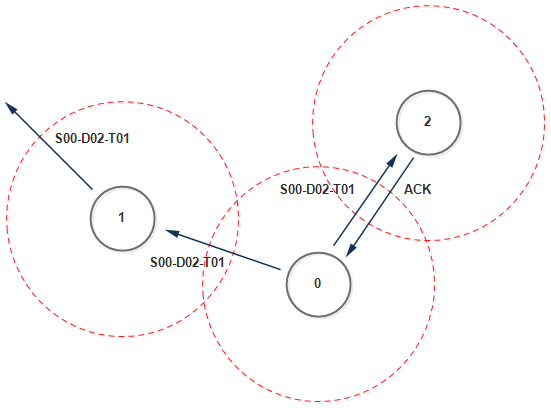
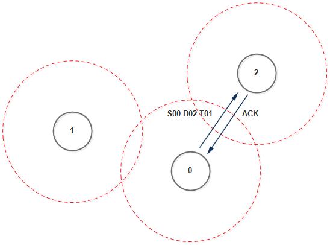
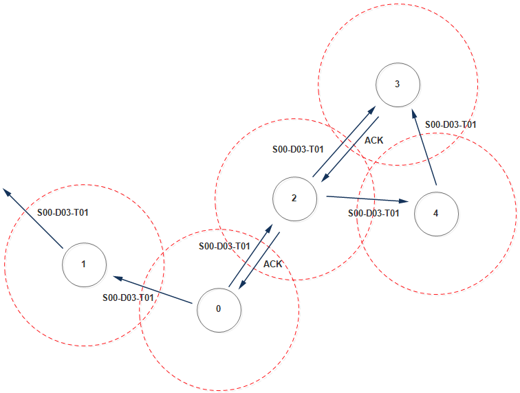

# ESP-NOW Mesh Protocol Library

### TLDR;
Lightweight and fast ESP-NOW (and more) mesh networking library for ESP32 devices.  
Supports multi-hop routing, acknowledgements, node discovery, and packet validation with minimal overhead.

### Overview
This library was developed for a specific use case. It's not revolutionary or world-changing; it simply addresses a problem that has already been solved many times by libraries like ESP-MESH, Meshstastic, and others. It does so for a particular scenario that I needed, and hopefully others might find it useful as well. I keep mentioning a specific use case, so let's break it down. 

In a large, remote house where tinkerers live, managing multiple custom IoT projects is just part of everyday life. Ensuring that all devices can communicate with each other without Wi-Fi makes the idea of a mesh network very sexy. The main challenge is to keep it simple (KISS - Keep It Simple, Stupid) while supporting various physical communication interfaces (such as ESP-NOW, radio modules).

This boils down to the following requirements:

* Small footprint: The library is ~470 lines of code (it could be smaller), with a protocol overhead of just 11 bytes (also potentially reducible).
* Portability: It requires very little change.
* Multi-interface support: It must support multiple communication interfaces. (user-defined `meshPacket_OnDataRecv` and `meshPacket_OnDataSent` functions).

---

## Table of Contents
- [Features](#features)
- [How Does It Work](#How-Does-It-Work)
  - [Route Discovery](#Route-Discovery)
  - [Route Selection](#Route-Selection)
  - [Mesh Hopping](#Mesh-Hopping)
  - [Safety Mechanisms](#Safety-Mechanisms)
  - [Route Aging](#Route-Aging)
- [Installation](#installation)
- [Configuration](#configuration)
- [Getting Started](#getting-started)
  - [Initialize the Mesh](#1-initialize-the-mesh)
  - [Define Message Handler](#2-define-message-handler-(optional))
  - [Process Packets](#3-process-packets)
  - [Handle Incoming Packets](#4-handle-incoming-packets)
  - [Sending a Message](#5-sending-a-message)
  - [Sending a Beacon](#6-sending-a-beacon)
- [Limitations](#limitations)
- [License & Author](#license--author)
- [TODO](#todo)
---

## Features
- Multi-hop routing via ESP-NOW (default)
- Cost-based route selection (accumulated path cost carried in the header) with hysteresis and smoothing
- Automatic route aging and management
- Flood routing via beacon for better route discovery (route request / route reply)
- End-to-end ACK packets (delivery confirmation; see [Limitations](#limitations), no library-level retries yet)
- Duplicate packet suppression
- Automatic ESP-NOW peer management (peers added on first use, pruned when no route uses them)
- Packet queueing (FreeRTOS)
- User-defined packet handler and message handler callbacks
- Very low overhead – designed for IoT nodes
---

## How Does It Work?
Protocol piggy-backs on WiFi protocol and consists of the following header. 

```
struct __attribute__((packed)) meshPacket_t
{
  uint8_t sourceID;
  uint8_t destinationID;
  uint8_t packetType;
  uint8_t payloadLength;
  uint8_t TTL;
  uint16_t uniqueIdentifier;
  uint8_t pathCost;
  uint8_t reserved[3];
  char payload[244];
};
```

The whole header consists of 11 bytes, suitable for embedded systems like ESP32. The maximum payload size is 239 bytes (ESP-NOW limit of 250 bytes minus the header). `pathCost` carries the accumulated route cost (see Route Selection); the `reserved` bytes are currently unused.

Reserved device IDs: `DEVICE_ID_DATABASE` (250), `DEVICE_ID_BROADCAST` (254) and `DEVICE_ID_UNCONFIGURED` (255). Routes to broadcast and unconfigured IDs are never learned.
Packet types: `TELEMETRY` (0), `CONTROL` (1), `NOTIFICATION` (2), `ACKNOWLEDGEMENT` (100), `BEACON` (101).

### Route Discovery
 \
Opportunistic route discovery mechanism is used. Devices learn routes simply by receiving packets, making the routing table management automatic and reactive.

The above example shows how routes are built. Upon initial transmission a source node (S00) sends a packet to a destination (D02) for which it has no established route (no match in routing table), it fallbacks to broadcasting the packet to all its neighbors (FF:FF:FF:FF:FF:FF).
Intermediate nodes (ex., Node 01) receive the broadcast packet. If the packet is not for them, they forward it. During this forwarding process, the reverse path: "to reach Sxx, forward via MAC" is opportunistically learned. This learned route is then stored.
The intended recipient (D02) receives the packet, fires a callback and sends an ACK back to the source. This ACK also travels along a learned reverse path, reinforcing the direct connection.

 \
Once a route (or its reverse) is learned, next time S00-D02-T01 packet is transmitted direct path is used, significantly improving efficiency. Unicast next hops are registered as ESP-NOW peers on first use, so the ESP-NOW link layer retries each hop. If there is no route (or the peer table is full) the packet falls back to broadcast flooding. Note that the library itself does not yet retransmit packets whose end-to-end ACK never arrives (see [Limitations](#limitations)).

**Beacons.** `meshPacket_sendBeacon(..)` floods a broadcast beacon. Every configured node that receives it handles it locally *and* forwards it, so it reaches multi-hop neighbours. Configured nodes answer with an ACK (source = first entry of `acceptedDeviceIDs`), which travels back along the reverse path and teaches every node on the way a route to the responder. Unconfigured devices (`DEVICE_ID_UNCONFIGURED`) forward beacons but never ACK them. Other broadcast packets are not ACKed.

### Route Selection
Each route stores the next-hop MAC, the accumulated path cost, and (for display) the hop count derived from TTL and a smoothed last-hop RSSI. The source sends `pathCost = 0`; every node that receives a packet adds the cost of the link it arrived on and forwards the packet with the new value:

```
link cost = MESH_PACKET_COST_PER_HOP + link penalty
path cost = sum of the link costs from the source to this node
```

Every hop converts its own RSSI into a cost, so only the cost travels in the packet (transport independent). A received `pathCost` is clamped to what is possible for the packet's hop count. The link penalty grows linearly from 0 (RSSI at or above `MESH_LINK_RSSI_GOOD_DBM`, default -80 dBm) to `MESH_LINK_MAX_PENALTY` (RSSI at or below `MESH_LINK_RSSI_POOR_DBM`, default -95 dBm). Rules:

* A different next hop replaces the current route only if its cost is lower by more than `MESH_PACKET_ROUTE_COST_HYSTERESIS` (default 5). This avoids route flapping.
* Packets (and duplicate copies) arriving via a worse alternative do not refresh `lastSeen`, so a dead best route can still expire.
* When a route is refreshed through the same next hop, the stored RSSI and cost are smoothed (3/4 old + 1/4 new), so a single fade does not swing the cost.
* All nodes must run a version with `pathCost` (v1.9.0+); older firmware does not add link costs.

### Mesh Hopping
 \
A mesh network wouldn't be complete without hopping. The above example shows initial transmission with more nodes than in the previous example. By following the logic described in **Route Discovery** section it can be seen
how S00-D03 message is sent and ACK is received. This example is important to show to understand a few important points.

Backward routes are learned from the first copy of a packet that arrives, but they are re-evaluated as more packets come in: a cheaper path (see [Route Selection](#route-selection)) replaces the current one once it beats it by the hysteresis margin.
Duplicate copies of a flooded packet (for example the same packet relayed by a neighbour) are also used for route learning, but only to refresh or replace an existing route, never to create one, and only if their TTL is at most 1 lower than the first copy's. This ignores our own forwarded packet echoed back by a neighbour. The packet itself is still handled only once.

### Safety Mechanisms
Since, a fallback transmission rely on broadcasting duplicate messages cannot be avoided in congested areas. To manage this, the protocol stores a `uniqueIdentifier` in each packet header.
When a device receives a packet, it checks the `uniqueIdentifier` and `sourceID`. If a match is found, the packet is dropped to prevent duplicates. Unique processed packets are remembered (table size is 25 entries, oldest overwritten first). \
Additionally, the packet header includes a TTL (Time To Live), borrowed from the TCP/IP protocol. This parameter controls the maximum number of hops a packet can have. Each time the packet is routed, the TTL is decremented (default `MESH_PACKET_HOP_LIMIT` is 5). This mechanism helps optimize route discovery and prevents potential routing loops. \
To mitigate network saturation in heavily congested areas, flood control is implemented by introducing slight random delays before forwarding packets. Each packet experiences a delay of 1 to 5 milliseconds, reducing the chances of collision and/or broadcast storms.

### Route Aging
To prevent stale nodes from sabotaging the network, route aging is used. Each device's routing table includes a `lastSeen` timestamp, which is updated every time a packet from a node is received via the current next hop. If no packets are received from a particular node for longer than `MESH_PACKET_NODE_EXPIRE_TIME_MS` (default 15 minutes), that route is considered stale and is removed from the routing table. ESP-NOW peers that no remaining route uses are then removed too.
Note that a failed delivery does not invalidate a route; only expiry does.

---

## Installation
1. Download or clone this repository
2. Place it in your Arduino libraries directory:

```
Documents/Arduino/libraries/meshProtocol/
```

3. Restart Arduino IDE
---

## Configuration

Compile-time options in `meshProtocol.h`:

| Define | Default | Meaning |
|---|---|---|
| `ENABLE_DEBUG_MESSAGES` | enabled | Debug messages via `meshPacket_messageHandler(..)`. Comment out for production. |
| `MESH_PACKET_MAX_ROUTES` | 30 | Routing table size (max 255). |
| `MESH_PACKET_CACHE_SIZE` | 25 | Seen-packet cache size (max 255). |
| `MESH_PACKET_HOP_LIMIT` | 5 | Initial TTL. |
| `MESH_PACKET_QUEUE_LENGTH` | 36 | RX queue length. |
| `MESH_PACKET_PENDING_ACKS` | 20 | Pending ACK slots. |
| `MESH_PACKET_NODE_EXPIRE_TIME_MS` | 900000 | Route timeout (15 min). |
| `MESH_PACKET_ROUTE_COST_HYSTERESIS` | 5 | Cost margin required to replace a route. |
| `MESH_PACKET_COST_PER_HOP` | 10 | Cost of one hop. |
| `MESH_LINK_RSSI_GOOD_DBM` / `MESH_LINK_RSSI_POOR_DBM` | -80 / -95 | RSSI range of the link penalty. Retune per radio. |
| `MESH_LINK_MAX_PENALTY` | 25 | Maximum link penalty. |
| `MAX_PEERS` | 20 | ESP-NOW peer limit. |
| `MAX_IOT_DEVICES` | 128 | Devices tracked by `meshPacket_getActiveDeviceCount(..)` (max 255). |

---

## Getting Started

### 1. Initialize the Mesh

Call in `setup()`:

```cpp
meshPacket_init(uint8_t wifiChannel); //- Set the channel to match a Wi-Fi channel (default is 1).
```

---

### 2. Define Message Handler (optional)

Define a custom message handler by overriding a weak declaration. This step is optional if debug messages and routing table is not required.

```cpp
__attribute__((weak)) void meshPacket_messageHandler(const char *message)
{
//	Serial.print(message);
}
```

---

### 3. Process Packets

Call in `loop()` or a FreeRTOS task:

```cpp
void meshPacket_processPackets(uint8_t *acceptedDeviceIDs, uint8_t acceptedDeviceCount, uint32_t waitTime_ms);
```

`acceptedDeviceIDs` the pointer sets the accepted device IDs, so packets can be filtered accordingly. Use `(uint8_t[]){LOCAL_DEVICE_ID}, 1` to accept only native device.
`acceptedDeviceCount` make sure it matches device count in a `acceptedDeviceIDs` pointer. \
`waitTime_ms` specifies the wait time for new mesh packets when the queue is empty. Set it to `0` if this feature is not used.

---

### 4. Handle Incoming Packets

Override the weak callback (example):

```cpp
void meshPacket_handlePacketCallback(meshPacket_t *localPacket)
{
  switch(localPacket->packetType)
  {
    case PACKET_TYPE_CONTROL:
    {
      Serial.println("Control packet received!");
      break;
    }
    default:
    {
      Serial.printf("[ERROR]: S%02d, D%02d, invalid T%02d received\n", localPacket->sourceID, localPacket->destinationID, localPacket->packetType);
      break;
    }
  }
}
```
---

### 5. Sending a Message

```cpp
uint8_t payload[] = { 1, 2, 3, 4 };
meshPacket_sendMessage(LOCAL_DEVICE_ID, DEVICE_ID_MPPT_CONTROLLER, PACKET_TYPE_CONTROL, payload, sizeof(payload));
```

### 6. Sending a Beacon

The beacon can be used to discover mesh neighbors after a device powers up. Route discovery is handled automatically. Additionally, users can use `meshPacket_handlePacketCallback(..)` to respond to beacon packets with configuration commands or other application-specific actions.

```cpp
meshPacket_sendBeacon(LOCAL_DEVICE_ID);
```

---

## Limitations

* **No library-level retransmission.** ACKs are tracked, but unacknowledged packets are not resent (`checkRetransmissions()` is not finished). Reliability relies on ESP-NOW link-layer retries for unicast; broadcast fallback has none. Applications that need guaranteed delivery must retry themselves.
* **Slow failover.** A failed unicast does not drop its route; the route only disappears after `MESH_PACKET_NODE_EXPIRE_TIME_MS`.
* **Not confirmed to be thread-safe.** Routing table, cache and pending-ACK table are not protected by locks. Call the library from one task.
* **No security.** Packets and peers are unencrypted and `sourceID` is not authenticated, so a foreign device on the same channel can spoof nodes or poison routes.
* **Cost is a snapshot.** Link RSSI is measured when a packet arrives and is not aged, so a link that went silent keeps its last cost until the route expires. RSSI shows how loud a neighbour is, not how well it hears us (asymmetric links).
* **All nodes relay.** There is no sleeping/non-relaying node mode.
* **Beacon replies** use only the first entry of `acceptedDeviceIDs` as the source ID.
* The 25-entry seen-cache and 16-bit UIDs can wrap on very busy networks, letting stale duplicates through.

---

## License & Author

MIT / Beerware.

If you find this useful, buy the author a beer 🍺 :) \
**Dovydas Bružas, Lithuania** <Dovydisimo@gmail.com>

---

## TODO

Detailed to do's are inside the .h file. Highlights:

- Finish ACK-driven retransmission and drop the route after a failed unicast.
- Add locking (semaphores) around shared tables.
- Optional authentication/encryption using the `reserved` header field.
- User-configurable `meshPacket_OnDataRecv` / `meshPacket_OnDataSent` for non-ESP-NOW interfaces.
- Benchmark statistics.

